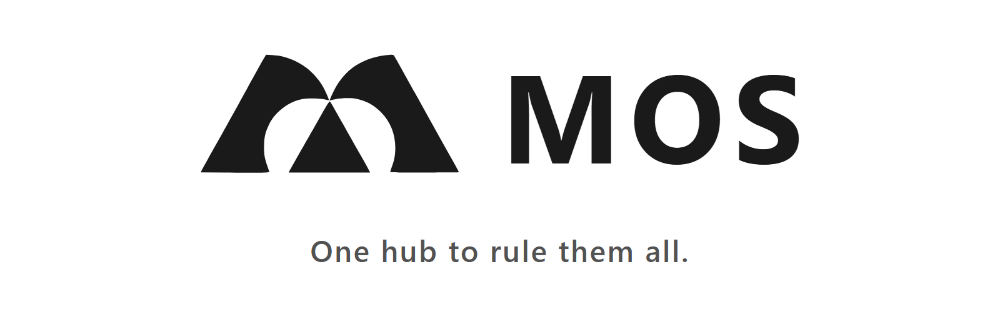
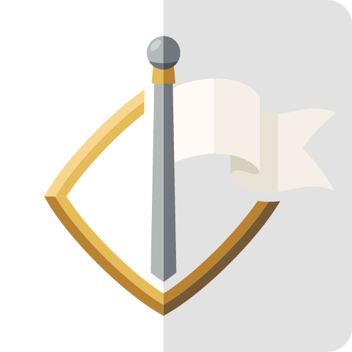
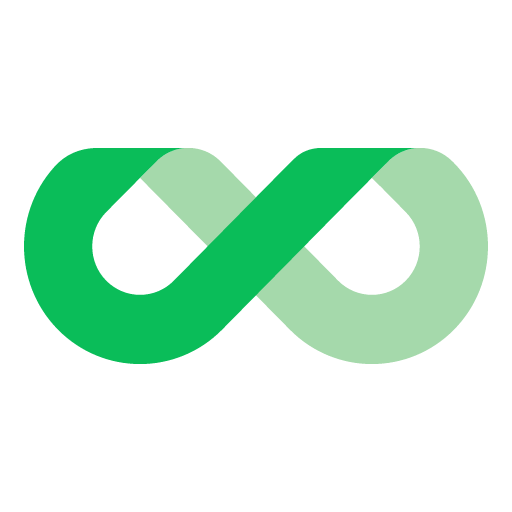
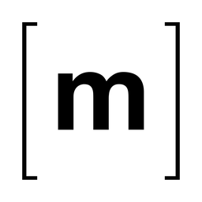

<p align="center">
  <picture>
    <source media="(prefers-color-scheme: dark)" srcset=".github/assets/banner-dark.png">
    
  </picture>
</p>

<p align="center">
  <a href="https://github.com/junkerderprovinz/mos-apps/actions/workflows/generate.yml"></a>&nbsp;
  <a href="#apps"></a>&nbsp;
  <a href="https://github.com/junkerderprovinz/mos-apps/commits/main"></a>&nbsp;
  <a href="https://github.com/mos-nas/mos-releases"></a>&nbsp;
  <a href="LICENSE"></a>
</p>

<p align="center">
<b>MOS Hub</b> templates for junkerderprovinz's containers on <a href="https://github.com/mos-nas/mos-releases">MOS</a>, the modular server OS by ich777, grouped like the profile: <b>Apps</b> (my own software), <b>Images</b> (my own image builds of third-party apps) and <b>Wrappers</b> (thin templates over an upstream image). One repository to add to the hub; each app's image and full source live in its own repository.
</p>


<!-- apps:start -->
## Apps

*My own software, built and published by junkerderprovinz. Full docs live in each app's own repository.*


<a href="https://github.com/junkerderprovinz/arrowloop#readme"></a>

**ArrowLoop**<br>
Two-way file sync that shows you the plan before it touches a file, sends deletions to a trash and stops a run that would delete too much.

<br clear="all">


<a href="https://github.com/junkerderprovinz/featherdrop#readme"></a>

**featherdrop**<br>
Your own private WeTransfer: feather-light, login-free, end-to-end encrypted file sharing with self-expiring share links.

<br clear="all">


<a href="https://github.com/junkerderprovinz/parleyport#readme"></a>

**ParleyPort**<br>
Your own relay for KnightLoader and BombVault: instances on different networks meet there, and it passes on what it cannot read.

<br clear="all">


<a href="https://github.com/junkerderprovinz/trickwork#readme"></a>

**TrickWork**<br>
Turns images into proportional-font-aware ASCII art - a rebuild of ASCII Gen 2, picking characters by real ink coverage, not brightness.

<br clear="all">


## Images

*My own custom image builds of third-party apps. Full docs in each app's own repository.*


<a href="https://github.com/junkerderprovinz/euro-office#readme"></a>

**Euro Office**<br>
Sovereign, OnlyOffice-compatible document server for browser editing of Office and OpenDocument files, wired into OpenCloud over WOPI.

<br clear="all">


<a href="https://github.com/junkerderprovinz/excalidraw#readme"></a>

**Excalidraw**<br>
The hand-drawn whiteboard, built so it keeps to itself: shared links, live collaboration, the session scene and even the fonts all come from your own server.

<br clear="all">


<a href="https://github.com/junkerderprovinz/garage#readme"></a>

**Garage**<br>
Garage's S3-compatible object store and its web admin panel in one container, with the single-node layout and S3 keys created automatically.

<br clear="all">


<a href="https://github.com/junkerderprovinz/handbrake#readme"></a>

**HandBrake**<br>
HandBrake's full GUI on a fast Selkies web desktop, GPU-accelerated on NVIDIA, Intel and AMD, with a watch folder that converts on its own.

<br clear="all">


<a href="https://github.com/junkerderprovinz/jdownloader#readme"></a>

**JDownloader**<br>
JDownloader 2 with a complete, sleek dark UI out of the box, on a fast Selkies web desktop in your browser. No VNC client, no install.

<br clear="all">


<a href="https://github.com/junkerderprovinz/juicefs#readme"></a>

**JuiceFS**<br>
The JuiceFS S3 gateway, with the file system created on first boot. Metadata goes to a database, file contents to an object store.

<br clear="all">


<a href="https://github.com/junkerderprovinz/krusader#readme"></a>

**Krusader**<br>
Twin-pane KDE file manager with a native dark theme on a fast Selkies web desktop, with Kate, krename and RAR built in.

<br clear="all">


<a href="https://github.com/junkerderprovinz/matrix#readme"></a>

**Matrix**<br>
A complete Matrix homeserver in one container: Synapse, coturn, Element Web and the Ketesa admin UI, with optional TURN over TLS.

<br clear="all">


<a href="https://github.com/junkerderprovinz/opencloud#readme"></a>

**OpenCloud**<br>
One-click OpenCloud file sync &amp; share: auto-runs init, heals appdata permissions and honours PUID/PGID.

<br clear="all">


<a href="https://github.com/junkerderprovinz/prusaslicer#readme"></a>

**PrusaSlicer**<br>
The PrusaSlicer 3D-printing slicer in your browser on a fast Selkies web desktop: slice and export G-code, no VNC client (amd64 + arm64).

<br clear="all">


<a href="https://github.com/junkerderprovinz/seafile#readme"></a>

**Seafile**<br>
The official Seafile server from one template, with its secrets generated on first start and MariaDB, Redis and the notification server built in on request.

<br clear="all">


<a href="https://github.com/junkerderprovinz/securo#readme"></a>

**Securo**<br>
The Securo finance manager with its worker and scheduler in one container, on your own PostgreSQL and Redis or on built-in ones.

<br clear="all">


<a href="https://github.com/junkerderprovinz/stellarium#readme"></a>

**Stellarium**<br>
The Stellarium planetarium in your browser on a fast Selkies web desktop: pan the sky, zoom a nebula, scrub through time, no VNC client.

<br clear="all">


## Wrappers

*Thin templates over a third-party upstream image (no custom build). Full docs in each app's folder below.*


<a href="https://github.com/junkerderprovinz/unraid-apps/blob/main/couchdb/README.md"></a>

**CouchDB**<br>
The HTTP/JSON document database behind Obsidian LiveSync, on the official 3.x image with data, config and CORS mapped so they survive a recreate or update.

<br clear="all">


<a href="https://github.com/junkerderprovinz/unraid-apps/blob/main/n8n/README.md"></a>

**n8n**<br>
Workflow automation connecting 400+ apps and APIs, on PostgreSQL by default, with every option exposed in the Unraid template form.

<br clear="all">


<a href="https://github.com/junkerderprovinz/unraid-apps/blob/main/rustfs/README.md"></a>

**RustFS**<br>
An S3 object store in Rust, with the two fixes it needs to run on Unraid at all. Pre-release: every version so far is a release candidate.

<br clear="all">


<a href="https://github.com/junkerderprovinz/unraid-apps/blob/main/seaweedfs/README.md"></a>

**SeaweedFS**<br>
Fast, S3-API-compatible object store on the official image, the actively-maintained alternative now that MinIO's open edition is done.

<br clear="all">


<a href="https://github.com/junkerderprovinz/unraid-apps/blob/main/silo/README.md"></a>

**Silo**<br>
MinIO, still maintained: PGSTY's fork of the open-source server, with the full web console. It reads an existing MinIO data folder as it is.

<br clear="all">


<a href="https://github.com/junkerderprovinz/unraid-apps/blob/main/standardnotes-webui/README.md"></a>

**Standard Notes Web UI**<br>
The official Standard Notes web client, self-hosted next to your own sync server for end-to-end encrypted notes in the browser.

<br clear="all">


<a href="https://github.com/junkerderprovinz/unraid-apps/blob/main/versitygw/README.md"></a>

**VersityGW**<br>
An S3 API in front of a share you already have: top-level folders become buckets, and every file stays readable over SMB and NFS at the same time.

<br clear="all">
<!-- apps:end -->


## Install

On MOS: open **Settings**, **System Configuration**, **MOS Hub Settings**, add `https://github.com/junkerderprovinz/mos-apps` to the repositories and refresh the hub. The apps then show up in the **MOS Hub** next to the ones from the other repositories.

Questions and bugs go to the issue tracker of the app's own repository; every template links it under **Support**.


## How these differ from the Unraid templates

The templates are built from the Unraid templates in [unraid-apps](https://github.com/junkerderprovinz/unraid-apps), with the changes MOS needs:

- Appdata goes to `/mnt/cache/appdata/<app>`, and paths that pointed at `/mnt/user` point at `/mnt/cache`. Change them if your pool has another name.
- `PUID` and `PGID` are `500`, the MOS default user.
- There is no `TZ` field, because MOS passes the system timezone to every container.
- Mounts drop Unraid's `slave` propagation, which Docker refuses on MOS.
- Optional paths and ports that the Unraid template leaves empty are left out, because MOS refuses an empty host field.
- MOS creates a missing appdata folder as root. Silo runs without Unraid's `--user 99:100` and RustFS as root, so they can write to it; n8n says in its description which `chown` to run before the first start.

To change a template, edit it in unraid-apps, not the files in `docker/`, `images/`, `.github/readme-icons/` or the app list in this README. A workflow here rebuilds them every night. To build them by hand:

```sh
python3 tools/generate.py ../unraid-apps
```

`apps.json` lists the apps that get a MOS template and their hub categories. Per app it can also set a different host path default (`paths`), replace a template field (`set`) or put a MOS note in front of the description (`note`).


## How AI is used here

One knight builds this, and AI is one of the tools I work with, the same way I work with an editor or a compiler. It helps me write code and documentation and it checks my work, and that saves me a good many evenings. It does not make the decisions, though. I read and understand everything before it ships, and if something here breaks, that is on me and not on the tool.

You do not have to take my word for it. The code is open and every release note is written by hand. The issue tracker shows how problems actually get handled, including the ones I got wrong the first time. If you find something that is not right, open an issue and I will look at it.

## Support

A one-knight job: I build them, keep them running, work through the issues and add what people ask for, until nothing is missing. They are free, with no accounts, no telemetry, no ads and no paid tier. No asterisk anywhere. Nothing readable ever leaves your own walls. Forged on evenings and weekends, with heart and stubbornness.

If one of these has earned a place on your server or computer, toss a coin to your knight: it helps cover the costs and keeps the project alive. It also makes this knight's heart beat a little faster. Three ways below, whichever suits you.

<p align="center">
  <a href="https://buymeacoffee.com/junkerderprovinz"></a>
  &nbsp;
  <a href="https://www.paypal.com/donate/?hosted_button_id=76FVV52TKXTUS"></a>
  &nbsp;
  <a href="https://junkerderprovinz.github.io/junkerderprovinz/"></a>
</p>
